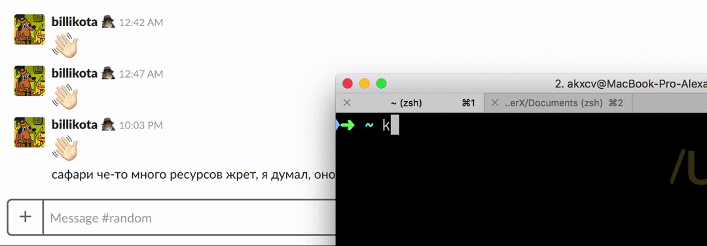

# krasivo

> Significa en ruso: de forma bonita



## Instalación

Puedes usar krasivo sin instalarlo mediante npm de la siguiente manera:
```sh
npx krasivo [your text] [foreground string] [background string]
```

Instala con [yarn](https://yarnpkg.com):
```sh
yarn global add krasivo
```

O, con npm:
```sh
npm i -g krasivo
```

## Uso

Para usarlo desde la línea de comandos:
```sh
krasivo [your text] [foreground string] [background string]
```

Para usarlo en código JS:
```js
import krasivo from 'krasivo'

console.log(krasivo('hello', 'x', ' '))
```

## API

Para obtener ayuda con la API, ejecuta:
```sh
krasivo --help
```

### Opciones disponibles:

#### - `shortEmoji` (predeterminado: `true`)
Cuando es `true`, los nombres de emojis como `:no_good:` se convierten en símbolos emoji de Unicode.

**Uso en CLI**:
```sh
krasivo hello :no_good: :no_entry: --short-emoji
# or:
krasivo hello :no_good: :no_entry: -e
# To disable:
krasivo hello :no_good: :no_entry: --no-short-emoji
```

**Uso en JS**:
```js
krasivo('hello', ':no_good:', ':no_entry:', { shortEmoji: true })
// To disable:
krasivo('hello', ':no_good:', ':no_entry:', { shortEmoji: false })
```

> Slack limita la longitud de los mensajes y, una vez superado el límite, la única forma de enviar el mensaje es como un "fragmento de código". El problema es que cada símbolo en un nombre de emoji se cuenta como un carácter independiente. La característica `shortEmoji` te permite usar cualquier emoji en tu mensaje al convertir los nombres de emojis en símbolos Unicode reales, los cuales tienen una longitud de 1 carácter en Slack.

#### - `skinTone` (predeterminado: `undefined`)
Al recibir un número (generalmente del 2 al 6), añade un tono de piel a los emojis que admiten variaciones. Siempre puedes especificar un tono de piel manualmente (`:no_good::skin-tone-6:`), lo cual anulará el valor especificado en `skinTone`. Es recomendable configurar esta opción en un [archivo de configuración local](#local-config-file).

**Uso en CLI**:
```sh
krasivo hello :no_good: :no_entry: --skin-tone=2
# or:
krasivo hello :no_good: :no_entry: -s 2
```

**Uso en JS**:
```js
krasivo('hello', ':no_good:', :no_entry:, { skinTone: 2 })
```

### Tonos de piel

Los tonos de piel se soportan en estilo Slack:

`":no_good:"` => 🙅

`":no_good::skin-tone-2:"` => 🙅🏻

`":no_good::skin-tone-3:"` => 🙅🏼

`":no_good::skin-tone-4:"` => 🙅🏽

`":no_good::skin-tone-5:"` => 🙅🏾

`":no_good::skin-tone-6:"` => 🙅🏿

## Archivo de configuración local

El CLI de Krasivo busca un archivo YAML `.krasivorc` en tu directorio principal. Por ejemplo, para configurar un tono de piel predeterminado y deshabilitar la sustitución de emojis, crea el siguiente archivo:

```yaml
# ~/.krasivorc
options:
  skinTone: 2
  shortEmoji: false
```

## Licencia

MIT
